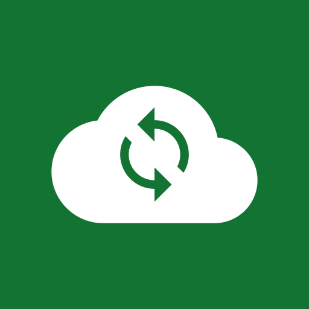

# ☁️ GoogleDriveSync


&nbsp;&nbsp;
[](https://github.com/tanvirsweb/Google-Drive-Sync/releases)
&nbsp;&nbsp;
[](https://github.com/tanvirsweb/Google-Drive-Sync/actions/workflows/release.yml)



GoogleDriveSync is a lightweight mobile application designed to seamlessly synchronize multiple local device folders with Google Drive storage.

---

## 🎯 What is it?

**GoogleDriveSync** is a native Java Android app that keeps folders on your phone in sync with folders in your Google Drive. It uses [rclone](https://rclone.org), bundled inside the app, to do the syncing. Your files always live in a normal folder on your device, so they stay available offline.

## ✨ Features

1. **Multi-folder syncing:** Pair multiple local mobile folders with specific Google Drive directories. Pick several Drive folders at once and each one is stored in its own sub-folder of the device folder you choose.
2. **Automated background sync:** Keep files updated automatically in real time or on scheduled intervals.
3. **Flexible sync modes:** Support for one-way uploading, one-way downloading, and two-way synchronization.
4. **Selective file filters:** Filter sync tasks by file type, size, or custom extension rules.
5. **Conflict management:** Built-in options for file replacement, keeping newest files, or preserving dual copies.
6. **Offline first:** Files are always kept on the device; syncs wait for a connection and nothing is deleted because Drive was unreachable.

See the **[User Guide](USAGE.md)** for how to use it, and **[BUILD_INFO.md](BUILD_INFO.md)** for building and releasing.

---

## ⚙️ How it works

| Feature | Implementation |
| --- | --- |
| Multi-folder syncing | Each *folder pair* (device folder ⇄ Drive folder) is a Room row with its own settings. When adding, you can tick several Drive folders at once; each one is stored in `<destination>/<folder name>` on the device and becomes its own pair. |
| One-way upload / download | `rclone copy` (or `rclone sync` when *Mirror deletions* is on). |
| Two-way sync | `rclone bisync --resilient --recover`, with the baseline rebuilt automatically when needed. |
| Background sync | WorkManager periodic jobs (15 min – 24 h), optional Wi-Fi-only / charging-only. |
| Real-time sync | A foreground service watches the device folder and queues a sync 10 s after changes settle. |
| Filters | File-type include/exclude, min/max size, skip hidden files, raw rclone filter rules. |
| Conflicts | *Replace*, *Keep newest* (`--update` / `--conflict-resolve newer`), *Keep both* (`--suffix` / `--conflict-loser num`). |

### Offline mode: your files stay on the device

* The device folder is a normal folder, so every file in it can be opened offline. Download-only
  pairs keep a full copy on the device.
* All sync work needs a network connection to start. While you are offline, syncs wait in
  WorkManager's queue and run once you are back online. Nothing is deleted or rolled back because
  Drive could not be reached.
* Downloads never delete device files unless you turn on *Mirror deletions*.
* With *Keep local backups* (on by default), any device file that a sync would overwrite or
  delete is moved to the app's backup folder first and kept for 30 days (you can change this).
* rclone writes downloads to a temporary `*.partial` file and renames it when it finishes, so a
  dropped connection never leaves a half-written file in place of a good one.

### Google sign-in

*Account → Sign in with Google* runs `rclone authorize drive`. rclone opens a loopback server
on `127.0.0.1:53682`, the sign-in page opens in your browser, and the token goes to rclone's
config in app-private storage. To use your own quota, create a **Desktop app** OAuth client in
Google Cloud Console and enter its ID and secret in the app before signing in. If you leave them
empty, rclone's shared client is used. Nothing is baked into the build.

---

## 🛠️ Building

Requirements: JDK 21, Android SDK (compileSdk 34), **Go** (≥ the version in rclone's `go.mod`)
and the **Android NDK**.

```sh
scripts/build-rclone.sh          # cross-compiles rclone into app/src/main/jniLibs/<abi>/librclone.so
./gradlew assembleDebug          # also runs the script automatically if a binary is missing
./gradlew testDebugUnitTest
```

The script builds a trimmed rclone (`rclone-android/`: only the Google Drive and local backends
and the commands the app uses, ~26 MB instead of ~85 MB) with cgo against the NDK, so DNS goes
through Android's resolver.
Pure-Go builds can't resolve host names on Android. The binary is packaged as a native library
(`useLegacyPackaging`), so the installer extracts it into `nativeLibraryDir`, the only place an
app may execute files from. Gradle builds one APK per ABI plus a universal APK.

Full build, versioning and release instructions are in **[BUILD_INFO.md](BUILD_INFO.md)**.

The app needs **All files access** (Android 11+) because rclone works on real filesystem paths.

---

## 📥 Download

Pre-built APKs are on the [Releases](https://github.com/tanvirsweb/Google-Drive-Sync/releases) page. Most phones need the `arm64-v8a` APK; the `universal` APK works everywhere.

## 🔒 Security

See [SECURITY.md](SECURITY.md) for how to report a vulnerability and how the app protects your data.

## 📄 License

This project is open-source and released under the [MIT License](LICENSE).

GoogleDriveSync includes these open-source components:

| Component                                                        | License      |
| :--------------------------------------------------------------- | :----------- |
| [rclone](https://github.com/rclone/rclone) (bundled binary)      | MIT          |
| rclone's Go dependencies (compiled into the binary)              | Various permissive (MIT, BSD, Apache-2.0, MPL-2.0) |
| [Gson](https://github.com/google/gson)                           | Apache-2.0   |
| AndroidX (incl. Room, WorkManager) & Material Components          | Apache-2.0   |
